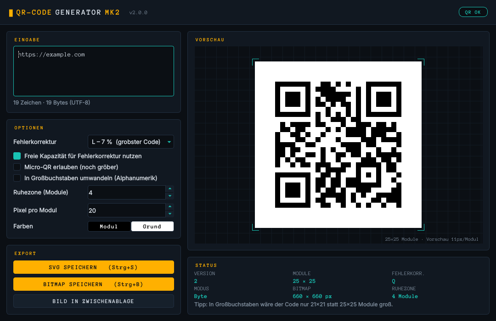

# QR-Code-Generator-MK2

**Version 2.0.0**

Eigenständiges Windows-Programm (keine Web-App) zum Erzeugen **möglichst grober QR-Codes** –
also mit so wenigen Modulen wie möglich, damit jedes einzelne Modul bei gleicher Druck-/Bildgröße
maximal groß wird. Export als **SVG** (Vektor) und als **Bitmap** (BMP oder PNG).



## Funktionen

- Text eingeben → QR-Code wird live erzeugt (auch `.txt`-Datei per Drag & Drop)
- Automatisch **kleinstmögliche QR-Version** und optimaler Kodierungsmodus (Numerisch / Alphanumerisch / Byte)
- Fehlerkorrektur wählbar – Standard **L (7 %)** ergibt den grobsten Code
- Option „Freie Kapazität für Fehlerkorrektur nutzen“: hebt die Fehlerkorrektur an, **ohne** den Code größer zu machen
- Option **Micro-QR** (11–17 Module, noch gröber – aber von vielen Handy-Apps nicht lesbar)
- Option **Großbuchstaben**: nutzt den kompakteren Alphanumerik-Modus (verändert den Inhalt!) –
  das Programm zeigt einen Tipp an, wenn das eine kleinere Version ergeben würde
- Ruhezone (Rand) und Pixel pro Modul einstellbar, Farben wählbar
- Export: **SVG** (`Strg+S`), **BMP/PNG** (`Strg+B`), Bild in die Zwischenablage
- Statusanzeige: Version, Modulanzahl, Fehlerkorrektur, Modus, Bitmap-Größe

## Download / Build

Der Build läuft automatisch über **GitHub Actions** (`.github/workflows/build-exe.yml`):

- Bei jedem Push auf `main`/`master` → ZIP als Artefakt unter *Actions*
- Bei einem Tag `v*` (z. B. `v1.0.0`) → zusätzlich GitHub-Release mit der ZIP

Die ZIP enthält `QR-Code-Generator-MK2.exe` (einzelne Datei, keine Installation nötig) und diese README.
Zusätzlich wird das Offline-Build-Kit als eigene ZIP mitgeliefert.

## Offline bauen (ohne GitHub, ohne Internet am Windows-PC)

Im Ordner [`offline_build_kit/`](offline_build_kit/ANLEITUNG.md) liegt ein Kit nach dem Prinzip
**„Mac lädt, Win10 baut"**:

1. `1_mac_pakete_herunterladen.sh` – lädt auf dem Mac alle Wheels für Windows 64-Bit / Python 3.11
2. `2_win10_pakete_installieren.bat` – installiert sie auf dem Win10-PC offline in eine `venv` (mit SHA256-Prüfung)
3. `3_win10_exe_aus_zip_bauen.bat` – baut `QR-Code-Generator-MK2-v<Version>-windows.exe`
   mit denselben Optionen wie GitHub Actions

Das Kit kann im Projektordner bleiben (dann wird direkt daraus gebaut) oder separat mit der
Projekt-ZIP daneben benutzt werden. Details: [`offline_build_kit/ANLEITUNG.md`](offline_build_kit/ANLEITUNG.md).

## Lokal starten (Entwicklung)

```bash
pip install -r requirements.txt
python qr_generator.py
```

## Projektstruktur

```
QR-Code-Generator-MK2/
├─ .github/workflows/build-exe.yml   GitHub-Actions-Build (Windows-EXE + ZIP)
├─ offline_build_kit/                Offline-Build-Kit (Mac lädt, Win10 baut)
│  ├─ 1_mac_pakete_herunterladen.sh
│  ├─ 2_win10_pakete_installieren.bat
│  ├─ 3_win10_exe_aus_zip_bauen.bat
│  └─ ANLEITUNG.md
├─ assets/icon.ico                   Programm-Icon
├─ assets/icon.png
├─ docs/screenshot.png               Bild für die README
├─ qr_generator.py                   Programm (PySide6 + segno)
├─ requirements.txt                  feste Paketversionen (Actions + Offline-Kit)
├─ .gitattributes                    CRLF für .bat, LF für .sh
└─ README.md
```
